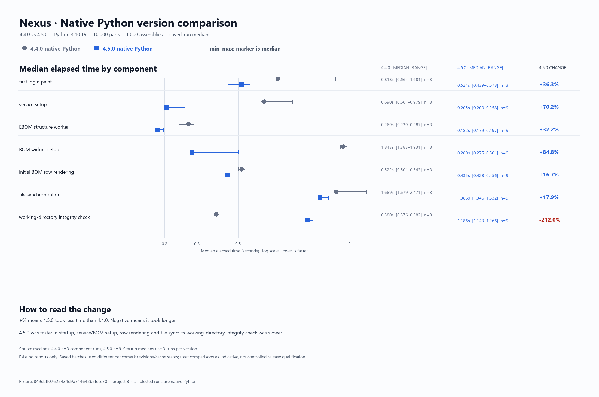
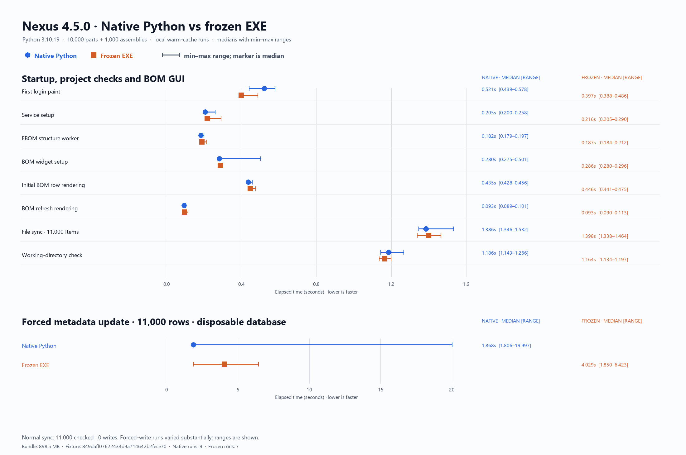

# Measuring startup and first project load

Nexus **4.5.0** reduces repeated repository setup in the BOM service graph,
defers diagnostics and less-used BOM services until needed, and imports the PDF
engine only when a PDF is opened. The normal workspace compatibility check,
license signature check, and revocation check still run during startup.

## What the startup probe measures

`tools/benchmark_startup.py` launches the real application and records elapsed
time through the first painted login screen. For an EXE run it uses the same
frozen executable and environment isolation as the packaging smoke checks. It
does not sign in or open a project; see `tools/benchmark_project_loading.py`
for project-load component timings.

The probe backs up the supplied SQLite database to a temporary directory and
uses temporary `%APPDATA%` and `%LOCALAPPDATA%`. It creates an ephemeral signing
key in memory, uses it to sign a one-day benchmark license and an empty
revocation list, and passes its public key through the existing development
override. It does not read or modify the release keys, user's license, settings,
or supplied database. The app performs its regular workspace and license
verification. Do not distribute the temporary benchmark license or key; neither
is saved by the tool.

Run from a Windows build environment:

```powershell
python tools/benchmark_startup.py `
  --database 'C:\path\to\creo_vcs.db' `
  --output docs/benchmarks/startup_source.json `
  --runs 3
```

To measure the packaged build, add `--exe` with the isolated EXE path:

```powershell
python tools/benchmark_startup.py `
  --database 'C:\path\to\creo_vcs.db' `
  --exe 'build\profiles\startup-optimized\dist\Nexus\Nexus.exe' `
  --output docs/benchmarks/startup_frozen.json `
  --runs 3
```

The login is painted offscreen so the run can finish unattended. Results include
stage medians and every run; compare repeated runs on the same computer and
database. This is a local warm-cache measurement through login, not an end-to-end
interactive session or a network-share performance guarantee.

## Isolated builds

Use `--profile-build` with `tools/build_exe.py` to keep comparison builds under
`build/profiles/<name>` without replacing the normal `dist/Nexus` package. For
example:

```powershell
python tools/build_exe.py `
  --profile-build startup-optimized `
  --release-public-key tools/licensing/keys/ed25519_public.key
```

The complete one-folder bundle is still required: PDF and CAD native libraries
remain packaged and available on computers that do not have those libraries
installed. Delayed PDF import avoids loading PyMuPDF at login; it does not remove
PDF support.

## Comparing BOM/checking performance

The application executable has an opt-in component benchmark dispatch for
engineering comparisons. It requires an explicit environment flag, and the
benchmark runner reads the supplied database, makes a disposable copy, and
performs its forced metadata rewrite only on a second disposable copy. The
working directory is read in place.

```powershell
$env:NEXUS_ENABLE_PERF_BENCHMARK = '1'
$arguments = @(
  '--performance-benchmark',
  '--database', 'C:\path\to\creo_vcs.db',
  '--project', '8',
  '--output', 'docs\benchmarks\company_11000_frozen.json'
)
$process = Start-Process `
  -FilePath 'build\profiles\performance-compare\dist\Nexus\Nexus.exe' `
  -ArgumentList $arguments -Wait -PassThru
Remove-Item Env:NEXUS_ENABLE_PERF_BENCHMARK
if ($process.ExitCode -ne 0) { throw "Benchmark failed: $($process.ExitCode)" }
```

The report includes service and structure setup, initial BOM GUI construction,
GUI refresh, working-directory checking, file/deliverable synchronization with
unchanged metadata, and a controlled rewrite after clearing derived base-name
metadata in a disposable database. Run the equivalent native-Python command
with `tools/benchmark_project_loading.py` and use the same database, project,
and computer. Repeat serially and compare medians and ranges.

## 4.5.0 comparison results

The comparison used Python **3.10.19**, project **8**, and synthetic dataset
`BENCHMARK - Company 11000`. Times below are medians with ranges in seconds;
native and frozen component runs used the same code, computer, DB fixture and
read-only CAD directory. The app bundle is about **898.5 MB**.

| Measurement | Native Python | Frozen EXE | EXE / native |
| --- | ---: | ---: | ---: |
| First offscreen login paint (3 runs) | 0.521 (0.439–0.578) | 0.397 (0.388–0.486) | 0.76× |
| Service setup (9 / 7 runs) | 0.205 (0.200–0.258) | 0.216 (0.205–0.290) | 1.05× |
| EBOM structure worker | 0.182 (0.179–0.197) | 0.187 (0.184–0.212) | 1.02× |
| BOM widget setup | 0.280 (0.275–0.501) | 0.286 (0.280–0.296) | 1.02× |
| Initial BOM row rendering | 0.435 (0.428–0.456) | 0.446 (0.441–0.475) | 1.03× |
| BOM refresh rendering | 0.093 (0.089–0.101) | 0.093 (0.090–0.113) | 1.01× |
| File sync, 11,000 Items; zero writes | 1.386 (1.346–1.532) | 1.398 (1.338–1.464) | 1.01× |
| Working-directory integrity check | 1.186 (1.143–1.266) | 1.164 (1.134–1.197) | 0.98× |
| Forced base-name metadata rewrite, 11,000 rows | 1.868 (1.806–19.997) | 4.029 (1.850–6.423) | 2.16× |

The regular scan made zero metadata writes in both runtimes. In the forced
rewrite case, the metadata fields were cleared only in the disposable copy, and
all 11,000 rows were regenerated. Those write times were noisy in both runtimes;
the native range includes a 20-second outlier. Treat the 2.16× median as a
signal to profile SQLite writes on the company share, not as a stable EXE
slowdown estimate. Startup and GUI timings were much steadier: frozen launch
was faster in these warm local runs, while BOM setup/rendering was within about
1–5% of native Python.

The individual timings are preserved in
[`runtime_comparison_4_5_0.json`](benchmarks/runtime_comparison_4_5_0.json),
with raw startup and component reports in `docs/benchmarks/`. These local tests
do not predict network-share latency.

## Native Python version comparison

The [4.4.0 vs 4.5.0 median comparison](benchmarks/runtime_comparison_4_4_vs_4_5_native.json)
uses only saved native-Python reports. It shows lower 4.5.0 medians for startup,
service and BOM setup, row rendering, and file synchronization. The saved
working-directory integrity check median is higher for 4.5.0 (1.186 s vs
0.380 s). The benchmark batches used different revisions/cache conditions, so
read the ranges and treat this comparison as indicative. No tests or benchmark
runs were repeated to make this version comparison.





## Local measurements

Reports in `docs/benchmarks/` record the computer, Python version, app version,
and measurement scope. The 4.4.0 frozen baseline and 4.5.0 optimized frozen
build each reached the first offscreen login paint in a **0.664-second median**
over three runs. The 4.5.0 source run measured 0.715 seconds. The optimized
package preserves the measured frozen login time; the main improvements are in
BOM service/page initialization and delaying the PDF engine until it is needed.
Use the project-load component reports to evaluate those separately.

The 11,000-item synthetic project is described in the
[benchmark project guide](../tools/README_benchmark_project.md). Its warm-cache
component timings vary with filesystem cache and machine load, so retain raw
runs and avoid presenting a single run as a company-network guarantee.
